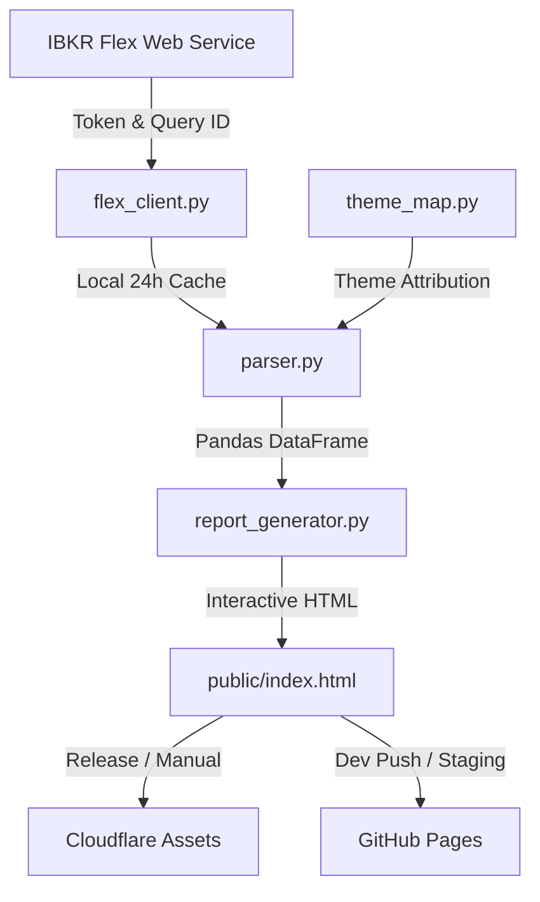

# IBKR Portfolio Reporting & Theme Attribution

[](https://www.python.org/downloads/)
[](LICENSE)

An automated portfolio analytics and reporting tool for **Interactive Brokers (IBKR)**. It fetches statements via the IBKR Flex Web Service, attributes realized and unrealized PnL across custom investment themes and underlying tickers, and compiles a rich, standalone interactive dashboard.

---

## Features

- **Automated Flex Web Service Client**:
  - Securely requests and polls IBKR Flex reports with exponential backoff and retry handling on server errors.
  - Automatically caches responses locally (`flex_report_cache.xml`) for 24 hours during local development to avoid rate limits.
- **Theme Attribution & Asset Categorization**:
  - Classifies positions and underlying symbols into macro/sector themes (e.g., *Big Tech*, *AI & Chips*, *Software*, *Energy*, *Space & Defense*, *Broad Market*, *Hedges*, etc.).
  - Unmapped tickers automatically fall back to `"Other"` for easy tracking.
- **Interactive Standalone Dashboard (`public/index.html`)**:
  - **KPI Header**: Net FIFO PnL, Realized PnL, Unrealized PnL, and Active Holding counts.
  - **Dynamic Visualizations**: Plotly bar charts, realized/unrealized breakdown, and net diamonds.
  - **Deep-Dive Drilldown**: Click on any theme to inspect constituent individual tickers and their contributions.
  - **Holdings Toggle**: Switch between currently open/active positions and complete historical performance.
  - **Live Search & Highlights**: Quick-search tickers and review top/bottom performers instantly.
  - **Dark / Light Mode**: Built-in modern theme switcher with persistent styling.
- **Data Sampling for Dev & Previews**:
  - Configurable random sampling (`--sample-rate`) to test layouts, share sanitized demos, or deploy staging previews without publishing the full portfolio.
- **Multi-Cloud CI/CD**:
  - **Production**: Deploys the full report to Cloudflare on GitHub Releases.
  - **Development**: Builds and deploys sampled preview reports to GitHub Pages on pushes to `dev`.

---

## Architecture & Data Flow



---

## File Structure

```text
ibkr-reporting/
├── .github/
│   └── workflows/
│       ├── deploy.yml            # Production deployment to Cloudflare
│       └── deploy-pages-dev.yml  # Dev preview deployment to GitHub Pages
├── flex_client.py                # IBKR Flex API client with polling & local caching
├── parser.py                     # XML statement parser & portfolio sampling logic
├── theme_map.py                  # Ticker-to-theme mapping definitions
├── report_generator.py           # Dashboard generator & Plotly visualization engine
├── main.py                       # CLI orchestrator & pipeline entry point
├── build_report_html.py          # Legacy/workflow entry point wrapper
├── wrangler.jsonc                # Cloudflare Pages/Assets configuration
├── requirements.txt              # Minimal project dependencies
└── .env                          # Local credentials (git-ignored)
```

---

## Getting Started

### 1. Prerequisites

- Python 3.10 or higher
- An active Interactive Brokers account with **Flex Web Service** enabled.

#### Configuring IBKR Flex Web Service
1. Log in to **IBKR Client Portal / Account Management**.
2. Navigate to **Performance & Reports** → **Flex Queries**.
3. Under **Flex Web Service**, generate a **Token** and note your **Current Token**.
4. Under **Custom Flex Queries**, create a new Query (Activity Statement / FIFO Performance Summary) and save your **Query ID**.

---

### 2. Installation

Clone the repository and install the dependencies:

```bash
git clone https://github.com/<your-username>/ibkr-reporting.git
cd ibkr-reporting

# Create and activate a virtual environment
python3 -m venv .venv
source .venv/bin/activate

# Install requirements
pip install -r requirements.txt
```

---

### 3. Environment Variables

Create a `.env` file in the project root:

```ini
IBKR_FLEX_TOKEN=your_ibkr_flex_token_here
IBKR_QUERY_ID=your_ibkr_query_id_here
```

---

## Usage

### Generate Full Report (Production)
Fetch statement from IBKR (or recent local cache) and build the complete dashboard:

```bash
python main.py
# or
python build_report_html.py
```
Open the generated report in your browser:
```bash
open public/index.html
```

---

### Generate Sampled Report (Development / Preview)
To test UI changes or generate a sanitized preview using a random subset of your portfolio:

```bash
# Random sample with default 30% (0.3)
python main.py --sample-rate

# Custom sample fraction (e.g., 15%)
python main.py --sample-rate 0.15

# Reproducible sample with a fixed seed
python main.py --sample-rate 0.3 --seed 42

# Custom output destination
python main.py --output preview.html
```

#### CLI Options Reference
| Argument | Type | Default | Description |
| :--- | :--- | :--- | :--- |
| `--sample-rate` | `float` | `None` (`0.3` if flag passed without value) | Fraction of portfolio to randomly sample (between `0.0` and `1.0`). |
| `--seed` | `int` | `None` | Random seed for reproducible sampling (`None` produces fresh randomness each run). |
| `--output` | `string` | `public/index.html` | File path for the generated HTML dashboard. |

---

## Customizing Themes

Themes are maintained in [`theme_map.py`](theme_map.py). To add, remove, or reclassify tickers:

```python
THEME_MAP = {
    'Big Tech': ['AAPL', 'AMZN', 'GOOGL', 'META', 'MSFT', 'NVDA', 'TSLA'],
    'AI & Chips': ['AMD', 'AVGO', 'INTC', 'MU', 'QCOM', 'PLTR', ...],
    'Software': ['ADBE', 'CRM', 'CRWD', 'SAP', 'SNOW', ...],
    # Add your custom themes and symbols here
}
```

Any ticker found in your statement that is not explicitly defined in `THEME_MAP` will automatically be grouped under **`Other`**, making it easy to identify new positions that need classification.

---

## Deployment & CI/CD

### 1. Cloudflare Deployment (Production)
Configured in [`.github/workflows/deploy.yml`](.github/workflows/deploy.yml).
- **Trigger**: Published GitHub release or manual `workflow_dispatch`.
- **Target**: Cloudflare Pages / Static Assets via Wrangler.
- **Required GitHub Secrets**:
  - `IBKR_FLEX_TOKEN`
  - `IBKR_QUERY_ID`
  - `CLOUDFLARE_API_TOKEN`
  - `CLOUDFLARE_ACCOUNT_ID`

### 2. GitHub Pages Deployment (Dev Preview)
Configured in [`.github/workflows/deploy-pages-dev.yml`](.github/workflows/deploy-pages-dev.yml).
- **Trigger**: Automatic on `push` to `dev`, or manual `workflow_dispatch` with custom `sample_rate`.
- **Setup in GitHub**:
  1. Go to repository **Settings** → **Pages** → set **Source** to **GitHub Actions**.
  2. Under **Settings** → **Environments** → **github-pages**, ensure `dev` is permitted under **Deployment branches**.

---

## Security & Privacy

- **Do NOT commit `.env` or statement XML files**: Keep API credentials and downloaded financial reports private. Both `.env` and `*.xml` are included in `.gitignore`.
- **Dev Sampling**: When previewing or testing publicly, utilize `--sample-rate` to avoid exposing the full composition and scale of your portfolio.

---

## License

This project is licensed under the [MIT License](LICENSE).
